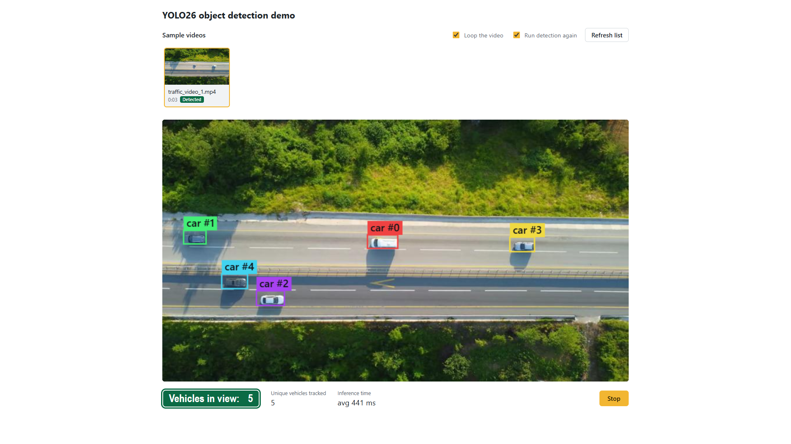
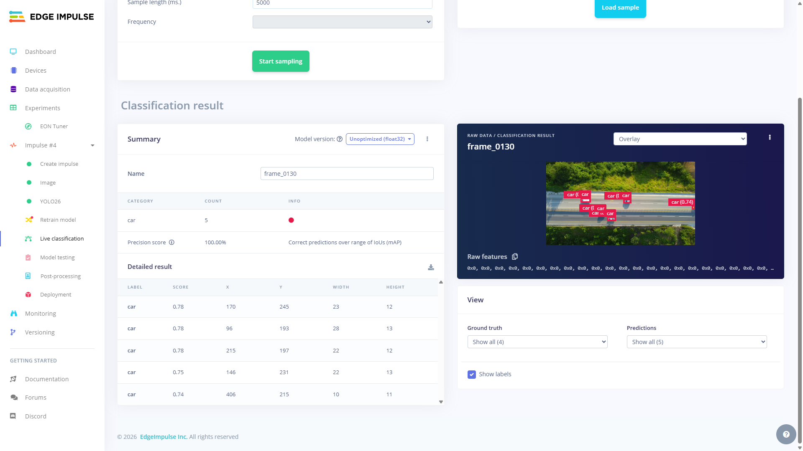
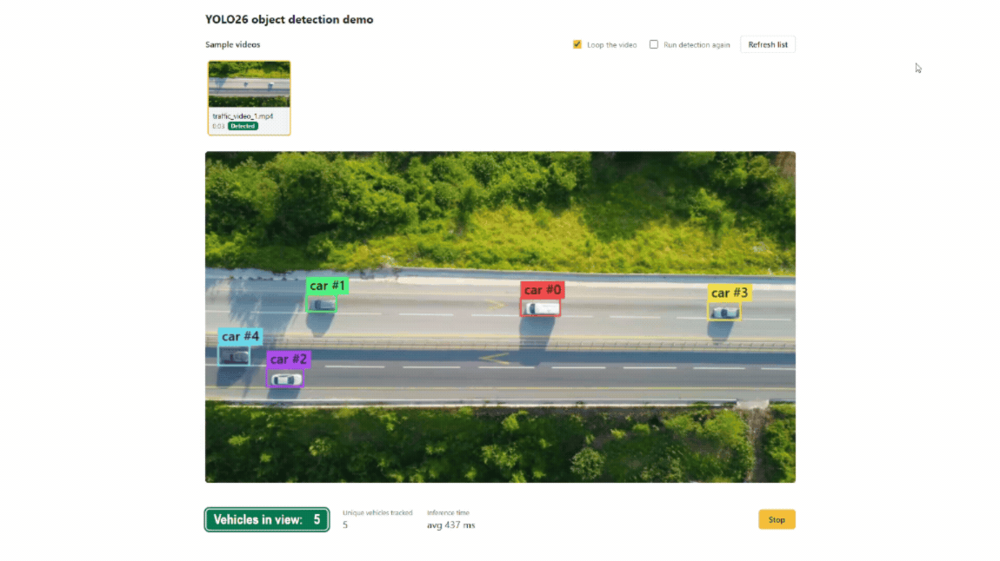
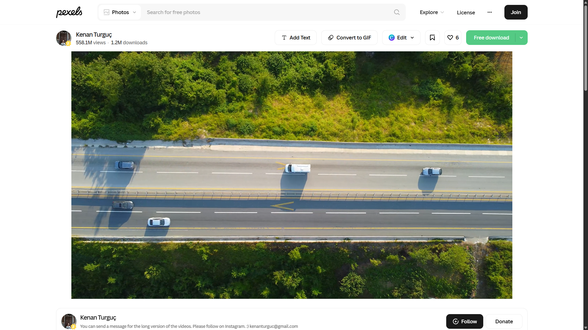

# YOLO26 Object Detection on Arduino UNO Q



The demo is a web application that loads sample videos, detects and tracks the objects in them, and plays the result in a web interface. Copy a video to the `/sample_videos` folder and watch your Edge Impulse deployed YOLO26 model track trained objects. The video footage used to extract car images for the training dataset was sourced from [Pexels](https://www.pexels.com/video/drone-aerial-view-of-cars-on-highway-in-nature-30973709/).

👉 [Explore YOLO26 project in Studio](https://studio.edgeimpulse.com/public/1168120/latest)



```
yolo26-arduino-uno-q-demo/
├── app.yaml               App Lab config (web_ui brick only)
├── python/
│   ├── eim_client.py      Talks to the .eim (same protocol as the Edge Impulse SDK)
│   └── main.py            Reads video file, runs the .eim, streams frames + tracks
├── assets/                Web UI (index.html, style.css, app.js)
├── models/                Put your model .eim here
└── sample_videos/         Put your videos here
```

The App Lab bricks (`video_object_detection`, `object_detection`) need a USB
camera, so this app doesn't use them. It runs your `.eim` directly through a
small built-in client (no extra Python packages). There is no Arduino sketch:
nothing runs on the STM32 microcontroller.



## Setup

1. **Turn on object tracking in Edge Impulse Studio**, then deploy again.
   Open *Post-processing* in the left navigation, choose *SORT* under
   *Object tracking*, click *Save*, and the model deploy to the Arduino UNO Q (CPU).
   The tracking runs inside the model file, so without it the app shows plain
   detections with no IDs.
2. **Clone and copy this repository to the board**, for example from your computer:
   ```bash
    scp -r yolo26-arduino-uno-q-demo arduino@<board-ip>:/home/arduino/ArduinoApps/
   ```
3. **On Edge Impulse, deploy your model for the UNO Q. Next, copy your downloaded .eim model file into the  /models directory** on the board:
   ```bash
    scp -r modelfile.eim arduino@<board-ip>:/home/arduino/ArduinoApps/yolo26-arduino-uno-q-demo/models
   ```
   Then set `MODEL_FILE` at the top of [main.py](python/main.py) to the .eim file name.
4. **Add videos** to `sample_videos/`. I would recommend that you use this [sample video](https://www.pexels.com/video/drone-aerial-view-of-cars-on-highway-in-nature-30973709/), which was used to generate the training images.



5. In App Lab, open **My Apps**, select *YOLO26 object detection* and click
   **Run**. The first launch installs the Python package, so give it a minute.
   The Web UI is at `http://<board-ip>:7000`.

## Settings (top of [main.py](python/main.py))

| Setting | What it does |
| --- | --- |
| `MODEL_FILE` | File name of your model in `models/`. |
| `COUNT_LABELS` | Classes to draw and count. Empty = all classes. |
| `RESIZE_MODE` | Used only if the model doesn't report its resize mode. Must match the Image block in Studio (`squash`, `fit-shortest`, `fit-longest`). |
| `MIN_SCORE` | Minimum confidence of a detection, applied to the model at start (default `0.4`; Studio's own value is in the log). Lower it if vehicles are missed, raise it for fewer false boxes. `None` keeps the model's value. |
| `AUTO_PROBE` | On the first playback of a video, tries the model on a few frames with every resize mode and colour order and uses the one that finds vehicles. Takes a few seconds, once per video. |
| `ANALYSIS_FPS` | `None` (default): every frame goes through the model, which gives the best tracking. A number such as `10` analyses every 3rd frame of a 30 fps video, about 3 times faster, and interpolates the boxes in between. Fast vehicles can then lose their IDs more often. |
| `REPLAY_MAX_FPS` | Most frames per second sent to the browser during replay (default 30). |
| `STREAM_WIDTH`, `JPEG_QUALITY` | Size and quality of the saved frames (default 800 px wide). |

The object tracker settings (max age, min hits, IoU threshold) are baked into the model. Change them in Studio under *Post-processing* and deploy again. They count in frames, so they behave best when the board processes frames at a steady rate.

## Troubleshooting

- **Boxes are stretched or shifted.** Set `RESIZE_MODE` to match the Image
  block's resize mode in Studio.
- **"Model not found".** The file named in `MODEL_FILE` must be in `models/`.
  Run the app again after copying it.
- **"Could not start the model".** The `.eim` must be a Linux aarch64 build. If
  you deployed the GPU target, redeploy with the CPU *Arduino UNO Q* target.
- **Nothing is detected.** A quantized (int8) build can lose small objects
  completely. Deploy the unoptimized (float32) build and try again. Each start
  also prints the model's parameters and thresholds in App Lab's log, followed
  by one `probe` line per resize mode and colour order. If every probe line
  says 0 detections, the banner in the UI says so too.
- **Detection takes long.** About a second per frame is normal on the board
  for a 640 px model. Use a shorter clip or set `ANALYSIS_FPS = 10`. It only
  happens once per video.
- **Saved results use too much space.** Delete `.cache/results/` in the app
  folder; results are rebuilt when you play a video again.
